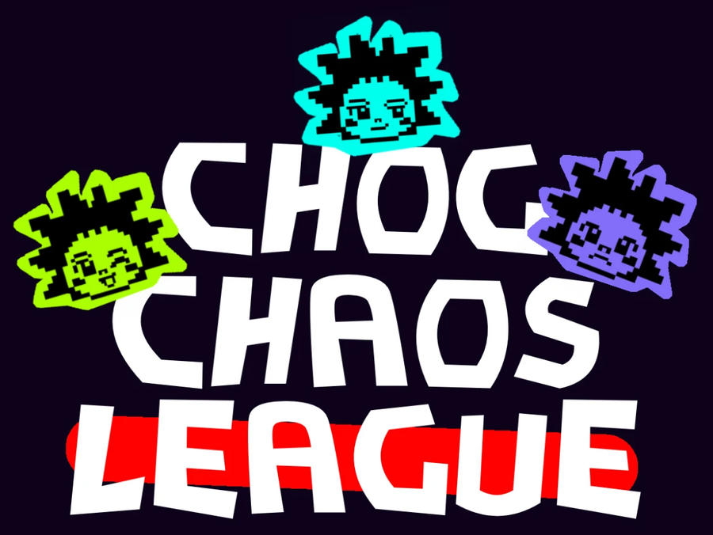

<p align="center">
  
</p>

<p align="center">
  <b>Your Chog is not a picture. It is a creature with a career.</b><br/>
  All 1,969 Chog Genesis NFTs live in one pixel meadow, causing provably fair chaos on Monad. The record follows the token.
</p>

<p align="center">
  <a href="https://chog-chaos-league.vercel.app">Live demo</a> ·
  <a href="https://chog-chaos-league.vercel.app/fairness">Fairness</a> ·
  <a href="https://chog-chaos-league.vercel.app/test-guide">Testing guide</a> ·
  <a href="contracts/src/ChaosLedger.sol">ChaosLedger</a>
</p>

---

Built for **Chogathon 2026**.

## What it is

Chog Chaos League turns every token of the [Chog Genesis collection](https://monadscan.com/address/0xc96d31f8626c6d03fae5dcd3d61e3fb9f4a73763) (1,969 NFTs on Monad) into a mischievous creature in a shared meadow. A Chog's real traits become its genes: **Mischief, Nerve, Wit, Speed and Charm**. Every hour a round pairs the Chogs for a Prank Heist, Meme Duel, Meadow Race or Alliance Betrayal. Chogs play on their own, so the meadow is fun to watch even if you never touch it. The holder of a Chog steers it with one signed nudge a day: **Bold**, **Sneaky** or **Friendly**.

Every result is replayable. Press **Replay** on any event and your browser re-runs the engine from the stored inputs and the Monad block hash that seeded the round. Same inputs, same result, or the page says so.

## Why the NFT is essential

The organizers' test is: *if you removed the NFT, would the experience still work the same way?* Here it would not.

| The Chog is… | What it does | Without it |
| --- | --- | --- |
| **Character** | Its real traits are decoded into genes through a public, deterministic table built from the collection's metadata. | No creature, no genome. |
| **Key** | Only the current holder can set the daily nudge. The server verifies the signature and reads `ownerOf` on Monad before recording it, so a sold Chog is steered by its new owner. | A wallet without a Chog is told so and cannot nudge anything. |
| **Memory** | Season results are rolled into a Merkle root keyed by token ID, anchored in a small contract. A profile checks its proof in the browser. | Nowhere for a career to live. |

Spectating and the Sandbox need no wallet and award nothing. Playing needs a Chog.

## How fairness works

1. **The chain is the clock.** Round `r` is seeded by the hash of Monad block `111,518,000 + r × 9,000` (roughly one hour). A round closes once that block is 200 blocks behind head.
2. **Lock before seed.** Nudges lock 450 blocks before the seed block exists, so neither side can know the other.
3. **One engine.** A pure TypeScript module with no I/O and no hidden randomness runs on the server and in your browser. No gene weight exceeds 0.38, so no single trait decides a match.
4. **Hashed logs.** Each event stores its inputs, steps and a keccak256 log hash.
5. **Narration is text only.** The Chog Chronicle reads a finished result and can never change one. It uses templates today and has a drop-in slot for a model.

Event weights, the gene rules and every trait value are published on the [fairness page](https://chog-chaos-league.vercel.app/fairness). To verify an event outside the browser:

```bash
npm run verify -- r168-e3
```

### Scoring

Winner 10 to 20 points (10 plus 1 per 6 points of margin), loser 3, a draw 6 each, upset bonus +5 when the winner's pre-roll power was more than 4 lower. Alliance Betrayal replaces the last step with a betrayal draw: a lone betrayer takes 12 and the betrayed gets 2, nobody betraying is shared loot (6 each), and a double backstab is decided by totals (8 and 3).

### Replayed history

Rounds 0 to 167 (season 0) were computed from past Monad blocks before the real-collection league went live. They use the same engine and public seeds but no owner ever nudged them, and the site labels them **replayed history**. Live play and real nudges start at round 168 (season 1). Counters on the site count live rounds only.

## The gene table

`lib/genome/mapping.json` is generated from the real metadata by `scripts/build-data.mjs` (13 trait categories, 327 values). Every Chog starts at 40 in each gene. Aura, Eyes and Mouth shape Charm, Wit and Mischief; Body, Base and Form shape Speed and Nerve; Head adds Nerve and Wit; Tier gives a small all-round lift; Accessory is a tie-break; Background, Skin, Naked and Side are mostly cosmetic. A value's delta scales with how uncommon it is, plus a small deterministic variation, and each gene's trait bonus is capped at +30. The ten 1:1 Legendary Chogs get a flat bonus because they carry only two traits. Tests assert every real trait value maps without the fallback and that no gene exceeds the cap.

## Features

- **Wallet connect and Chog detection** on Monad (chain 143), read live from the contract (balance check, then an `ownerOf` scan through Multicall3, since the collection has no enumeration)
- **Genome decoder** with a published table and real trait coverage
- **Chaos engine** with four event types, seeded pairing for the whole collection (984 events per round) and stance counters
- **Replay and seed check** in the browser, plus an RPC comparison of the seed block hash
- **Pixel arena** drawn on canvas, mobile-first, reduced-motion aware, with a profile drawer per Chog
- **Real Chog art** on profiles, event pages and highlight cards; the pixel creature is the in-arena avatar
- **Daily nudge** signed with the wallet, with expiry and nonce, one per Chog per day, ownership checked on chain
- **Career record and ChaosLedger** contract with per-season Merkle roots and in-browser proof checks
- **Leaderboard and seasons** with weekly seasons, streaks, badges, rivalry of the week and a recap
- **Highlight cards** rendered server-side, with one-tap share to X
- **Sandbox** to practice with any two Chogs, with nothing stored and no points
- **Status page and health endpoint** for round, seed, RPC and nudge-store health

## Architecture

```
app/                 Next.js App Router: pages and API routes
  api/nudge          signed nudges: signature, expiry and on-chain owner check; one per Chog per day
  api/owned          Chogs held by a wallet, read from the contract
  api/card/[event]   highlight card (real art)
  api/img/[id]       cached proxy for the real Chog images
  api/season/[id]    public season summary and Merkle root
  api/health         health for monitors
components/          Arena canvas, replay panel, profile drawer, wallet UI, sandbox
lib/engine/          pure engine: PRNG, events, pairing  (shared by server and browser)
lib/genome/          trait to gene decoder and generated mapping table
lib/server/          collection data, seeds, rounds, seasons, nudge store, nudge validation
lib/merkle.ts        leaf hashing and proofs (matches ChaosLedger.sol)
data/collection.json real Chog Genesis metadata (ids, names, traits, image paths)
contracts/           ChaosLedger, Foundry tests, deploy script
scripts/             verify, build-data, fetch-collection, snapshot-seeds, deploy-ledger, anchor-season
tests/               engine, fairness, real-trait coverage, replay, Merkle and nudge-ownership tests
```

Rounds are derived, not stored. Given the chain and the nudge book, any instance computes the same rounds.

## Tech stack

| Library | Use |
| --- | --- |
| [Next.js 15](https://nextjs.org), [React 19](https://react.dev) | App framework, server rendering, `next/og` for cards |
| [viem](https://viem.sh) | Monad RPC reads, Multicall3, message signing and verification, ABI encoding |
| [@noble/hashes](https://github.com/paulmillr/noble-hashes) | keccak256 for log hashes and Merkle trees (per-event rolls use a public fast hash seeded by the block hash) |
| [sharp](https://sharp.pixelplumbing.com) | Converts Chog art for highlight cards |
| [solc](https://github.com/ethereum/solc-js) | Compiles ChaosLedger for the Foundry-free deploy script |
| [TypeScript](https://www.typescriptlang.org), [tsx](https://tsx.is) | Types and the test runner |
| Bowlby One, Space Grotesk, JetBrains Mono | Google Fonts through `next/font` |

All code in this repository was written for this hackathon; there is no reused game code. The Chog images and metadata belong to the Chog team, who confirmed the art may be used in this app. The league logo and wordmark are supplied brand art; the in-game pixel avatars are generated procedurally in the logo's style (`lib/sprite.ts`).

## Running it locally

```bash
npm install
npm run dev        # http://localhost:3000
npm test           # 15 tests: engine, fairness, real-trait coverage, replay, Merkle, nudge ownership
npm run typecheck
```

| Variable | Effect |
| --- | --- |
| `NEXT_PUBLIC_CHOG_CONTRACT` | Override the collection address (defaults to Chog Genesis) |
| `NEXT_PUBLIC_LEDGER_ADDRESS` | Verified badge compares proofs with the on-chain season root |
| `NEXT_PUBLIC_MONAD_RPC`, `NEXT_PUBLIC_MONAD_RPC_BACKUP` | RPC endpoints |
| `UPSTASH_REDIS_REST_URL`, `UPSTASH_REDIS_REST_TOKEN` | Durable nudge book (or Vercel KV's `KV_REST_API_URL` and `KV_REST_API_TOKEN`) |

### Refreshing data

```bash
node scripts/fetch-collection.mjs   # re-reads token URIs from the contract and metadata from IPFS
node scripts/build-data.mjs         # regenerates the gene table and name index
node scripts/snapshot-seeds.mjs     # caches seed block hashes of closed rounds
```

### Anchoring seasons on Monad

```bash
PRIVATE_KEY=0x... npm run deploy:ledger                                     # deploys ChaosLedger, prints the address
PRIVATE_KEY=0x... LEDGER=0x... npm run anchor -- 0                          # writes season 0's root
```

Use a fresh wallet funded with a little MON. Then set `NEXT_PUBLIC_LEDGER_ADDRESS` and redeploy. Anyone can recompute a season root from public data (`/api/season/<id>`) and compare it with the contract. Foundry users can run `forge test` and `forge script` in `contracts/`.

## Honest limits

- **Ledger.** ChaosLedger is deployed on Monad at [`0xa379…5143`](https://monadscan.com/address/0xa37942e9963d7e036f2b9e6d15c1597541c05143) and season 0 (replayed history) is anchored: its root `0x2f388a7f…bb5be2` is on chain and profiles show **Verified on Monad**. Season 1 is anchored once its 168 live rounds close, and until then it shows "Season live · proof valid".
- **Nudges.** Nudges are durable only when Redis is connected; the status page reports the live mode truthfully.
- **Autopilot.** Chogs whose holders never nudge play on seeded autopilot stances. Holders change stance for a day; they do not control results.
- **Metadata.** Traits and names come from the collection's cached IPFS metadata. The number in a name (for example CHOG #541) is not the token id.
- **Commentary.** Narration uses templates. A model can replace them without changing any result.
- No wagering, no price or return promises. The optional $CHOG shop is not built.

## Playtest results

Public playtest is in progress. Numbers and quotes will be added here only when they are real.

## Roadmap

- Rivalries, revenge events and owner-formed crews
- Chog team events and sponsored seasons
- More event types and maps
- Open season data so other builders can make companion apps
- $CHOG cosmetics with capped, non-wagering utility, once the team's guidelines are confirmed

## License

MIT. Chog and Monad names and artwork belong to their respective owners. This is an independent community project and is not endorsed by the Chog team.
